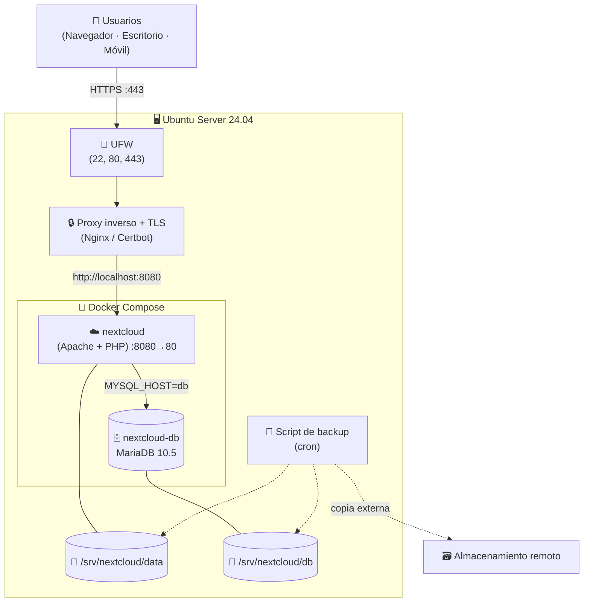

<div align="center">

# ☁️ Nextcloud Deployment

**Nube privada y autoalojada con Nextcloud, Docker y MariaDB sobre Ubuntu Server**


</div>

---

## 📑 Índice

- [Descripción](#-descripción)
- [El problema](#-el-problema)
- [La solución](#-la-solución)
- [Características](#-características)
- [Arquitectura](#-arquitectura)
- [Tecnologías utilizadas](#-tecnologías-utilizadas)
- [Requisitos](#-requisitos)
- [Inicio rápido](#-inicio-rápido)
- [Estructura del repositorio](#-estructura-del-repositorio)
- [Documentación](#-documentación)
- [Hoja de ruta](#-hoja-de-ruta)

---

## 📖 Descripción

Este repositorio documenta el **despliegue completo de un servicio de almacenamiento en la nube privado** basado en [Nextcloud](https://nextcloud.com/), un software libre y de código abierto. Todo el servicio se ejecuta en contenedores **Docker** sobre **Ubuntu Server 24.04**, con **MariaDB** como base de datos.

El proyecto cubre todo el ciclo de vida del servicio:

1. Preparación del servidor e instalación.
2. Configuración básica y gestión de usuarios.
3. Seguridad (HTTPS, firewall, MFA).
4. Copias de seguridad y restauración.
5. Mantenimiento y resolución de problemas.

## ❓ El problema

Muchas pequeñas empresas utilizan **Google Drive**, Dropbox u otros servicios de terceros, o directamente almacenan los archivos **localmente** en cada equipo. Esto provoca:

- ❌ **Falta de control** sobre dónde y cómo se guardan los datos.
- ❌ **Dependencia de un proveedor externo** y de sus precios y condiciones.
- ❌ **Riesgos de privacidad** y de cumplimiento normativo (RGPD).
- ❌ **Pérdida de información** cuando los datos solo existen en un equipo y este falla.

## ✅ La solución

Una **nube privada** basada en Nextcloud, instalada en un servidor propio, que ofrece:

- ✔️ **Soberanía de los datos**: los archivos nunca salen de la infraestructura de la empresa.
- ✔️ **Sin cuotas por usuario**: la capacidad depende únicamente del disco del servidor.
- ✔️ **Acceso desde cualquier lugar**: navegador web, aplicación de escritorio y móvil.
- ✔️ **Colaboración**: compartir archivos y carpetas, enlaces públicos, calendario, contactos…
- ✔️ **Despliegue reproducible**: con Docker Compose el servicio se levanta con un solo comando.

> 📊 Para una explicación más detallada del proyecto (objetivos, alcance, comparativa y conclusiones) consulta la **[presentación del proyecto](docs/presentacion.md)**.

## ✨ Características

| Área | Qué incluye |
|---|---|
| 🐳 **Contenedores** | Nextcloud y MariaDB desplegados con Docker Compose |
| 🗄️ **Base de datos** | MariaDB con datos persistentes en `/srv/nextcloud/db` |
| 🔒 **HTTPS** | Proxy inverso con certificados TLS de Let's Encrypt |
| 🧱 **Firewall** | UFW con solo los puertos necesarios abiertos |
| 🔐 **MFA** | Autenticación en dos pasos (TOTP) para los usuarios |
| 💾 **Backups** | Script de copia de datos + base de datos y procedimiento de restauración |
| 👥 **Usuarios** | Gestión de usuarios, grupos y cuotas de almacenamiento |

## 🏗️ Arquitectura

<div align="center">

</div>

Vista lógica del despliegue:



| Componente | Contenedor | Puerto | Persistencia |
|---|---|---|---|
| Nextcloud (Apache + PHP) | `nextcloud` | `8080 → 80` | `/srv/nextcloud/data` |
| MariaDB 10.5 | `nextcloud-db` | interno (3306) | `/srv/nextcloud/db` |

## 🧰 Tecnologías utilizadas

| Tecnología | Uso en el proyecto |
|---|---|
| **Ubuntu Server 24.04 LTS** | Sistema operativo del servidor |
| **Docker** | Ejecución de los servicios en contenedores aislados |
| **Docker Compose** | Definición y orquestación de los contenedores |
| **Nextcloud** | Plataforma de almacenamiento y colaboración |
| **MariaDB** | Base de datos relacional de Nextcloud |
| **UFW** | Firewall del sistema |
| **Nginx + Certbot** | Proxy inverso y certificados HTTPS (Let's Encrypt) |

## 📋 Requisitos

**Hardware mínimo recomendado**

| Recurso | Mínimo | Recomendado |
|---|---|---|
| CPU | 2 núcleos | 4 núcleos |
| RAM | 2 GB | 4 GB o más |
| Disco | 20 GB (sistema) | Disco adicional dedicado a datos |
| Red | IP fija en la red local | IP pública / dominio para acceso externo |

**Software**

- Ubuntu Server 24.04 LTS (instalación limpia)
- Usuario con permisos de `sudo`
- (Opcional) Un dominio apuntando a la IP del servidor para HTTPS

## 🚀 Inicio rápido

> Guía resumida. El paso a paso detallado está en **[docs/instalacion.md](docs/instalacion.md)**.

```bash
# 1. Instalar Docker y Docker Compose
sudo apt update && sudo apt upgrade -y
sudo apt install -y docker.io docker-compose-v2
sudo systemctl enable --now docker
```

```bash
# 2. Crear los directorios persistentes
sudo mkdir -p /srv/nextcloud/{data,db}
```

```bash
# 3. Clonar el repositorio
git clone https://github.com/Nyxazzz/nextcloud-deployment.git
cd nextcloud-deployment/docs
```

```bash
# 4. Editar las contraseñas en docker-compose.yml y levantar el servicio
nano docker-compose.yml
sudo docker compose up -d
```

Después abre `http://IP_DEL_SERVIDOR:8080` en el navegador y crea la cuenta de administrador. Continúa con la **[configuración básica](docs/configuracion.md)**.

> ⚠️ **Importante:** cambia **todas** las contraseñas por defecto (`admin`) del `docker-compose.yml` antes de poner el servicio en producción.

## 📂 Estructura del repositorio

```text
nextcloud-deployment/
├── README.md                  # Este documento
├── scripts/
│   └── backup.sh              # Script de copia de seguridad
└── docs/
    ├── presentacion.md        # Presentación del proyecto
    ├── instalacion.md         # Instalación paso a paso
    ├── docker-compose.yml     # Definición de los servicios
    ├── configuracion.md       # Configuración básica tras la instalación
    ├── usuarios.md            # Gestión de usuarios, grupos y cuotas
    ├── seguridad.md           # HTTPS, firewall, MFA y hardening
    ├── backups.md             # Copias de seguridad y restauración
    ├── mantenimiento.md       # Actualizaciones, logs y comandos occ
    ├── solucion-problemas.md  # Errores frecuentes y cómo resolverlos
    └── mejoras.md             # Mejoras futuras / hoja de ruta
```

## 📚 Documentación

| Documento | Descripción |
|---|---|
| 🎤 [Presentación](docs/presentacion.md) | Contexto, objetivos, alcance, comparativa y conclusiones |
| 🛠️ [Instalación](docs/instalacion.md) | Preparación del servidor, Docker y despliegue |
| ⚙️ [Configuración básica](docs/configuracion.md) | Asistente inicial, dominios de confianza, cron, apps |
| 👥 [Gestión de usuarios](docs/usuarios.md) | Usuarios, grupos, cuotas y permisos |
| 🔒 [Seguridad](docs/seguridad.md) | HTTPS, UFW, MFA, actualizaciones y buenas prácticas |
| 💾 [Backups](docs/backups.md) | Qué se guarda, cómo automatizarlo y cómo restaurar |
| 🔧 [Mantenimiento](docs/mantenimiento.md) | Actualizaciones, logs y comandos `occ` útiles |
| 🩺 [Solución de problemas](docs/solucion-problemas.md) | Errores habituales y su solución |
| 🗺️ [Mejoras futuras](docs/mejoras.md) | Hoja de ruta del proyecto |

## 🗺️ Hoja de ruta

- [x] Despliegue con Docker Compose (Nextcloud + MariaDB)
- [x] Firewall con UFW
- [x] Documentación de HTTPS, MFA y backups
- [ ] Fail2Ban para prevención de intrusiones
- [ ] Monitorización (Prometheus + Grafana / Uptime Kuma)
- [ ] Caché con Redis
- [ ] Integración con LDAP / Active Directory
- [ ] Alta disponibilidad

Detalle completo en **[docs/mejoras.md](docs/mejoras.md)**.

---

<div align="center">

Proyecto de despliegue de una nube privada con software libre · Hecho con ☁️ y 🐳

</div>
