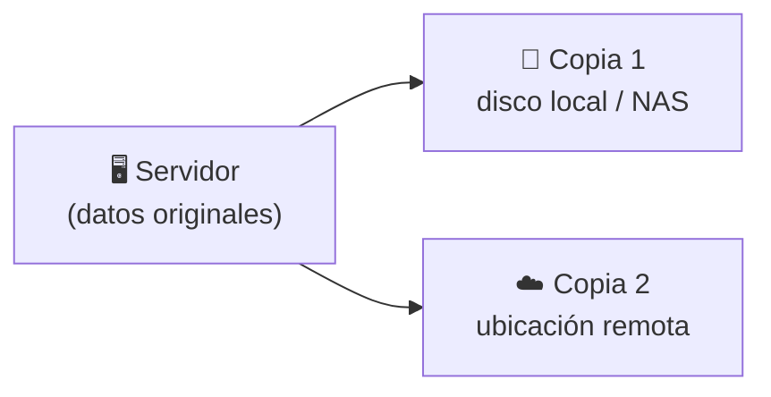

# 💾 Backups

← [Seguridad](seguridad.md) · [Volver al README](../README.md) · Siguiente: [Mantenimiento →](mantenimiento.md)

---

## Objetivo

Poder recuperar el servicio ante un fallo de cualquier índole (disco dañado, error humano, actualización fallida, ransomware…), aumentando la fiabilidad del servicio.

## Qué se guarda

| Elemento | Ubicación | Contiene |
|---|---|---|
| **Datos de usuarios** | `/srv/nextcloud/data/data/` | Archivos de cada usuario, versiones y papelera |
| **Base de datos** | Contenedor `nextcloud-db` (volcado SQL) | Usuarios, grupos, comparticiones, metadatos de archivos |
| **Configuración del servicio** | `/srv/nextcloud/data/config/` | `config.php`: ajustes, dominios, secreto de instalación |
| **Aplicaciones y versión** | `/srv/nextcloud/data/` (resto) | Apps instaladas, temas, versión del servicio |
| **Definición del despliegue** | `docker-compose.yml` | Imágenes, variables y volúmenes |

> ⚠️ Los datos y la base de datos **deben copiarse a la vez** (con el modo mantenimiento activo) para que sean coherentes entre sí.

## Estrategia 3-2-1



- **3** copias de los datos (el original + 2 backups).
- **2** soportes distintos (ej. disco del servidor y NAS/disco externo).
- **1** copia **fuera** del servidor (otro edificio, ordenador remoto o almacenamiento en la nube).

| Parámetro | Valor propuesto |
|---|---|
| Frecuencia | Diaria (de madrugada) |
| Retención | 7 copias diarias |
| Destino local | `/srv/backups/nextcloud` (idealmente en otro disco) |
| Destino remoto | Ordenador/servidor remoto mediante `rsync` sobre SSH |

## Backup automático

El repositorio incluye el script **[`scripts/backup.sh`](../scripts/backup.sh)**, que:

1. Activa el **modo mantenimiento** de Nextcloud.
2. Hace un **volcado de la base de datos** con `mysqldump` (usa las credenciales del propio contenedor).
3. Comprime el directorio **`/srv/nextcloud/data`** (instalación, configuración y archivos).
4. Desactiva el modo mantenimiento.
5. Borra las copias con más de **N días** de antigüedad.

### Instalación

```bash
sudo cp scripts/backup.sh /usr/local/bin/nextcloud-backup.sh
sudo chmod +x /usr/local/bin/nextcloud-backup.sh
sudo mkdir -p /srv/backups/nextcloud
```

### Ejecución manual

```bash
sudo /usr/local/bin/nextcloud-backup.sh
ls -lh /srv/backups/nextcloud
```

Variables configurables (al inicio del script o como variables de entorno):

| Variable | Por defecto | Descripción |
|---|---|---|
| `BACKUP_DIR` | `/srv/backups/nextcloud` | Carpeta de destino |
| `DATA_DIR` | `/srv/nextcloud/data` | Directorio de Nextcloud |
| `RETENTION_DAYS` | `7` | Días que se conservan las copias |
| `APP_CONTAINER` | `nextcloud` | Contenedor de Nextcloud |
| `DB_CONTAINER` | `nextcloud-db` | Contenedor de MariaDB |

### Programación con cron

```bash
sudo crontab -e
```

```cron
# Backup diario a las 03:00
0 3 * * * /usr/local/bin/nextcloud-backup.sh >> /var/log/nextcloud-backup.log 2>&1
```

### Copia remota

Tras el backup local, enviar las copias a otro equipo:

```bash
rsync -avz --delete /srv/backups/nextcloud/ usuario@servidor-remoto:/backups/nextcloud/
```

Se puede añadir al crontab a continuación del backup (ej. a las 04:00), usando autenticación por **clave SSH**.

## Restauración

En caso de fallo en la base de datos o en el servicio, se restauran los datos desde la copia más reciente (del propio servidor o del equipo remoto).

> Sustituye `FECHA` por la marca de tiempo del backup a restaurar (ej. `2026-11-24_0300`).

### 1. Parar Nextcloud

```bash
cd ~/nextcloud-deployment/docs
sudo docker compose stop app
```

### 2. Restaurar los archivos

```bash
sudo mv /srv/nextcloud/data /srv/nextcloud/data.old
sudo mkdir -p /srv/nextcloud/data
sudo tar -xzf /srv/backups/nextcloud/nextcloud-data_FECHA.tar.gz -C /srv/nextcloud/data
```

### 3. Restaurar la base de datos

```bash
sudo docker compose up -d db

# Vaciar y recrear la base de datos
sudo docker exec nextcloud-db sh -c 'exec mysql -uroot -p"$MYSQL_ROOT_PASSWORD" -e "DROP DATABASE IF EXISTS $MYSQL_DATABASE; CREATE DATABASE $MYSQL_DATABASE CHARACTER SET utf8mb4 COLLATE utf8mb4_general_ci; GRANT ALL PRIVILEGES ON $MYSQL_DATABASE.* TO \"$MYSQL_USER\"@\"%\";"'

# Importar el volcado
gunzip -c /srv/backups/nextcloud/nextcloud-db_FECHA.sql.gz | \
  sudo docker exec -i nextcloud-db sh -c 'exec mysql -u"$MYSQL_USER" -p"$MYSQL_PASSWORD" "$MYSQL_DATABASE"'
```

### 4. Arrancar y desactivar el modo mantenimiento

```bash
sudo docker compose up -d
sudo docker exec -u www-data nextcloud php occ maintenance:mode --off
sudo docker exec -u www-data nextcloud php occ maintenance:data-fingerprint
```

> `maintenance:data-fingerprint` avisa a los clientes de sincronización de que el servidor se ha restaurado, para que no borren archivos que tengan en local.

### 5. Comprobar y limpiar

- Iniciar sesión y verificar archivos, usuarios y comparticiones.
- Si todo es correcto, eliminar la copia antigua: `sudo rm -rf /srv/nextcloud/data.old`

## Pruebas de restauración

> **Un backup que no se ha probado no es un backup.**

- Probar la restauración al menos **una vez al trimestre**, preferiblemente en una máquina virtual de pruebas.
- Comprobar periódicamente el log `/var/log/nextcloud-backup.log` y el tamaño de las copias.
