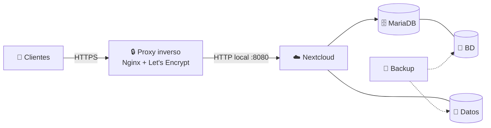
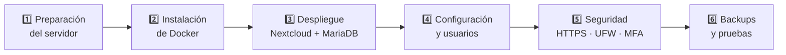

# 🎤 Presentación del proyecto

> Documento de apoyo para presentar el proyecto: contexto, objetivos, alcance, decisiones técnicas y conclusiones.

← [Volver al README](../README.md)

---

## 1. Contexto

Las pequeñas empresas y organizaciones generan y comparten a diario documentos, hojas de cálculo, imágenes y otros archivos. Lo habitual es optar por una de estas dos opciones:

| Opción | Inconvenientes |
|---|---|
| **Nube pública** (Google Drive, Dropbox, OneDrive) | Los datos están en servidores de terceros, coste mensual por usuario, dependencia del proveedor, dudas sobre privacidad y RGPD |
| **Almacenamiento local** (cada equipo / USB / carpeta compartida) | Sin acceso remoto, sin control de versiones, alto riesgo de pérdida de datos, difícil de compartir |

## 2. Objetivo

Desplegar una **nube privada** que ofrezca la comodidad de un servicio como Google Drive, pero **alojada en infraestructura propia** y basada en **software libre**.

### Objetivos específicos

- 🎯 Instalar y configurar un servidor **Ubuntu Server 24.04**.
- 🎯 Desplegar **Nextcloud** y **MariaDB** mediante **Docker Compose**.
- 🎯 Proteger el servicio con **HTTPS**, **firewall (UFW)** y **MFA**.
- 🎯 Gestionar **usuarios, grupos y cuotas** de almacenamiento.
- 🎯 Definir una **política de copias de seguridad** y de restauración.
- 🎯 **Documentar** todo el proceso para que sea reproducible.

## 3. Alcance

| Incluido ✅ | Fuera de alcance (mejoras futuras) ⏳ |
|---|---|
| Servidor único con Docker | Alta disponibilidad / clúster |
| Nextcloud + MariaDB | Redis, Collabora / OnlyOffice |
| HTTPS, UFW, MFA | Fail2Ban, IDS |
| Backups locales y externos | Monitorización centralizada |
| Gestión de usuarios local | Integración con LDAP / Active Directory |

## 4. ¿Por qué Nextcloud?

- **Software libre** (licencia AGPL) y con una comunidad muy activa.
- **Clientes oficiales** para Windows, macOS, Linux, Android e iOS.
- **Ecosistema de aplicaciones**: calendario, contactos, tareas, Talk, edición de documentos…
- **Cifrado**, autenticación en dos pasos y control granular de permisos.
- Ampliamente utilizado por administraciones públicas, universidades y empresas europeas.

## 5. ¿Por qué Docker?

| Ventaja | Explicación |
|---|---|
| **Reproducible** | Todo el servicio queda descrito en un único `docker-compose.yml` |
| **Aislado** | Nextcloud y la base de datos no "ensucian" el sistema operativo anfitrión |
| **Fácil de actualizar** | Actualizar = descargar la nueva imagen y recrear el contenedor |
| **Portable** | Se puede mover a otro servidor copiando el compose y los volúmenes |
| **Datos separados** | Los datos viven en `/srv/nextcloud`, independientes del contenedor |

## 6. Arquitectura

1. El usuario accede por **HTTPS** desde el navegador o las aplicaciones.
2. El **firewall** solo deja pasar los puertos necesarios (SSH, 80 y 443).
3. El **proxy inverso** termina el cifrado TLS y redirige la petición a Nextcloud.
4. **Nextcloud** guarda los archivos en disco y los metadatos en **MariaDB**.
5. Un **script de backup** copia periódicamente datos y base de datos.

## 7. Comparativa

| Criterio | Google Drive (Business) | Nextcloud autoalojado |
|---|---|---|
| Ubicación de los datos | Servidores de Google | Servidor propio |
| Coste | Cuota mensual por usuario | Solo hardware y electricidad |
| Capacidad | Limitada por el plan | Limitada por los discos |
| Privacidad / RGPD | Depende del proveedor | Control total |
| Personalización | Baja | Alta (apps, temas, integraciones) |
| Mantenimiento | Lo hace el proveedor | Lo hace la empresa |
| Disponibilidad | Muy alta | Depende de la infraestructura propia |

> 💡 La principal contrapartida de una nube privada es que **el mantenimiento y las copias de seguridad son responsabilidad propia**. Por eso este proyecto dedica documentación específica a [seguridad](seguridad.md), [backups](backups.md) y [mantenimiento](mantenimiento.md).

## 8. Fases del proyecto

| Fase | Documento |
|---|---|
| Preparación del servidor e instalación de Docker | [instalacion.md](instalacion.md) |
| Despliegue de los contenedores | [instalacion.md](instalacion.md) · [docker-compose.yml](docker-compose.yml) |
| Configuración básica y usuarios | [configuracion.md](configuracion.md) · [usuarios.md](usuarios.md) |
| Seguridad | [seguridad.md](seguridad.md) |
| Copias de seguridad | [backups.md](backups.md) |

## 9. Demostración sugerida

Guion para una demo en directo de unos 5–10 minutos:

1. Mostrar `docker compose ps` con los dos contenedores en ejecución.
2. Iniciar sesión en Nextcloud por **HTTPS** (mostrar el candado del navegador).
3. Crear un **usuario** y un **grupo**, asignar una **cuota**.
4. Subir un archivo y **compartirlo** con otro usuario y mediante enlace público.
5. Acceder desde el **móvil** o el cliente de escritorio y ver la sincronización.
6. Activar la **autenticación en dos pasos** en una cuenta.
7. Ejecutar el **script de backup** y mostrar los archivos generados.

## 10. Conclusiones

- Es posible ofrecer un servicio equivalente a una nube pública con **software libre** y **coste reducido**.
- Docker simplifica enormemente la **instalación, actualización y migración** del servicio.
- La **seguridad** (HTTPS, firewall, MFA) y los **backups** no son opcionales: son parte esencial del despliegue.
- El proyecto queda preparado para crecer con las [mejoras futuras](mejoras.md).
