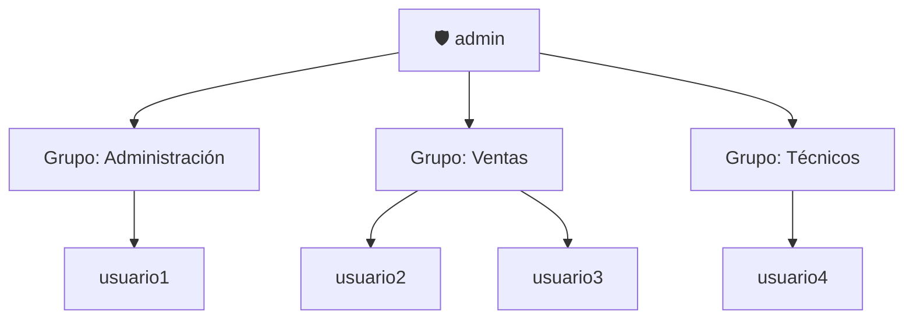

# 👥 Gestión de usuarios

Creación y administración de usuarios, grupos, cuotas y permisos.

← [Configuración básica](configuracion.md) · [Volver al README](../README.md) · Siguiente: [Seguridad →](seguridad.md)

---

## Modelo recomendado

Organizar a los usuarios por **grupos** (por departamento o función) y asignar permisos y carpetas compartidas a los grupos, no a usuarios individuales.



| Rol | Descripción |
|---|---|
| **Administrador** | Acceso completo a la configuración. Usar el mínimo número de cuentas posible |
| **Administrador de grupo (subadmin)** | Puede gestionar los usuarios de su grupo |
| **Usuario** | Acceso a sus archivos y a lo compartido con él |

## Desde la interfaz web

**Menú del perfil → Cuentas** (o *Usuarios* en versiones anteriores):

1. **Crear grupo**: botón *+ Añadir grupo* en el panel lateral.
2. **Crear usuario**: botón *+ Nueva cuenta* → nombre de usuario, nombre visible, contraseña, email, grupos y cuota.
3. **Cuota**: se puede definir por usuario (ej. `5 GB`, `20 GB`, `Ilimitada`).
4. **Deshabilitar / eliminar**: menú `⋯` de cada usuario.

## Desde la línea de comandos (`occ`)

> Alias usado en los ejemplos: `alias occ='sudo docker exec -u www-data nextcloud php occ'`
>
> Para comandos que piden contraseña de forma interactiva añade `-it` a `docker exec`:
> `sudo docker exec -it -u www-data nextcloud php occ ...`

### Grupos

```bash
occ group:add Ventas
occ group:list
```

### Usuarios

```bash
# Crear usuario (pide la contraseña de forma interactiva)
sudo docker exec -it -u www-data nextcloud php occ user:add --display-name="Ana López" --group="Ventas" ana

# Listar usuarios
occ user:list

# Añadir / quitar de un grupo
occ group:adduser Ventas ana
occ group:removeuser Ventas ana

# Restablecer la contraseña
sudo docker exec -it -u www-data nextcloud php occ user:resetpassword ana

# Deshabilitar / habilitar
occ user:disable ana
occ user:enable ana

# Eliminar (¡borra también sus archivos!)
occ user:delete ana
```

### Cuotas

```bash
# Cuota de un usuario
occ user:setting ana files quota "10 GB"

# Cuota por defecto para usuarios nuevos
occ config:app:set files default_quota --value="5 GB"
```

## Compartir archivos

| Tipo | Descripción |
|---|---|
| **Con usuario / grupo** | El elemento aparece en la cuenta del destinatario con los permisos elegidos (lectura, edición, compartir) |
| **Enlace público** | URL accesible sin cuenta. Se recomienda **contraseña** y **fecha de caducidad** |
| **Carpetas de grupo** | (App *Group folders*) carpeta común para todo un grupo, con cuota propia |

Políticas recomendadas en **Configuración de administración → Compartir**:

- ✅ Exigir contraseña en los enlaces públicos.
- ✅ Establecer una fecha de caducidad por defecto (ej. 7 días).
- ✅ Restringir con quién se puede compartir (solo dentro de los grupos del usuario, si procede).

## Buenas prácticas

- Una cuenta por persona; **no compartir credenciales**.
- **Activar MFA** para todos, obligatorio para administradores ([ver seguridad](seguridad.md#mfa)).
- Revisar periódicamente las cuentas inactivas: `occ user:lastseen <usuario>`.
- Deshabilitar (en lugar de eliminar) las cuentas de personas que dejan la empresa hasta revisar sus archivos.
